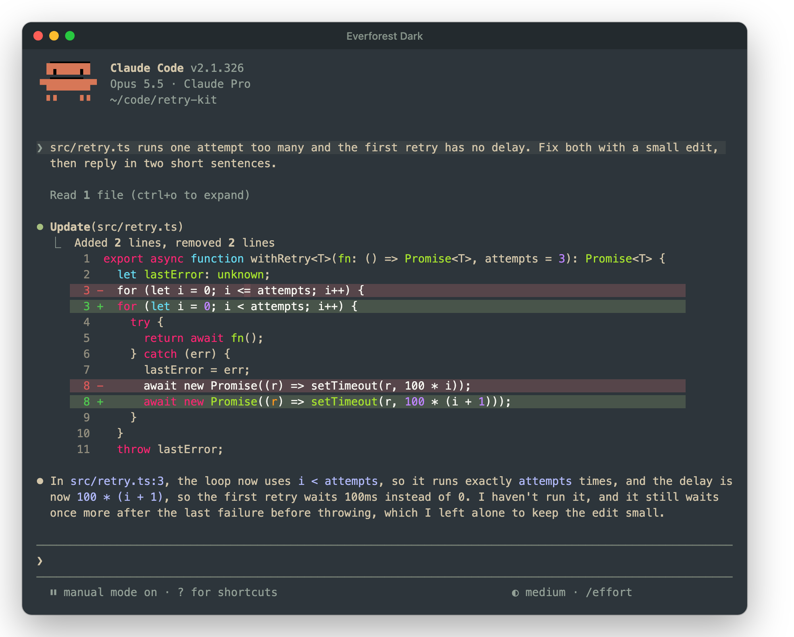

# Everforest for Claude Code

Everforest Dark and Everforest Light themes for Claude Code, with matching color schemes for 9 terminals. A free sample of the [claudcod Theme Pack](https://claudcod.com/themes/).



## Install

```sh
mkdir -p ~/.claude/themes
cp claude-code/*.json ~/.claude/themes/
```

Then run `/theme` in Claude Code and pick Everforest Dark or Everforest Light.

Claude Code themes don't change your terminal background, so set your terminal to the matching scheme from `terminals/`:

| Terminal | File | How |
|---|---|---|
| Ghostty | `ghostty/Everforest Dark` | Copy to `~/.config/ghostty/themes/`, then set `theme = Everforest Dark` |
| iTerm2 | `iterm2/Everforest Dark.itermcolors` | Double-click, then pick it in Settings > Profiles > Colors > Color Presets |
| macOS Terminal | `apple-terminal/Everforest Dark.terminal` | Double-click, then make it the default in Settings > Profiles |
| Kitty | `kitty/everforest-dark.conf` | `include` it from `kitty.conf` |
| WezTerm | `wezterm/everforest-dark.toml` | Copy to `~/.config/wezterm/colors/`, then set `config.color_scheme = 'Everforest Dark'` |
| Alacritty | `alacritty/everforest-dark.toml` | Add it to `import` under `[general]` in `alacritty.toml` |
| Windows Terminal | `windows-terminal/everforest-dark.json` | Paste into `"schemes"` in settings.json |
| VS Code | `vscode/everforest-dark.json` | Paste into your VS Code settings.json |
| Warp | `warp/everforest-dark.yaml` | Copy to `~/.warp/themes/`, then pick it in Settings > Appearance > Themes |

For the light theme, use the `Everforest Light` files the same way.

## What's included

- Everforest Dark and Everforest Light, each in three versions: standard, colorblind (blue and orange in place of green and red) and 256 colors (for terminals limited to 256 colors).
- All 63 Claude Code color tokens set, with contrast checked: 4.5:1 for text, 3:1 for borders and other UI parts.

## The full pack

The [claudcod Theme Pack](https://claudcod.com/themes/) has 27 themes: Catppuccin, Tokyo Night, Rosé Pine, Kanagawa, Gruvbox, Solarized, One Dark, Ayu, Night Owl, Nord and Everforest. It also adds a command that switches Claude Code and your terminal together:

```sh
claudcod-theme use rose-pine-dawn
```

## License

Everforest is by sainnhe, under the MIT license (see `LICENSE-everforest.txt`). The theme files here are MIT too (see `LICENSE`).

Not affiliated with or endorsed by Anthropic. Claude Code is a trademark of Anthropic.
